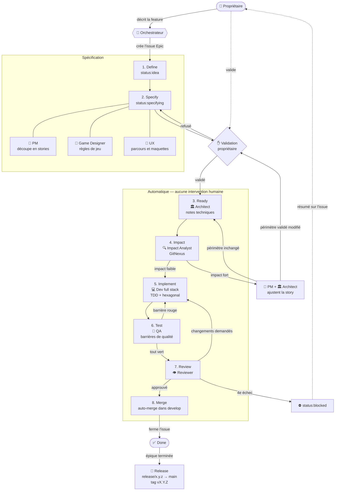
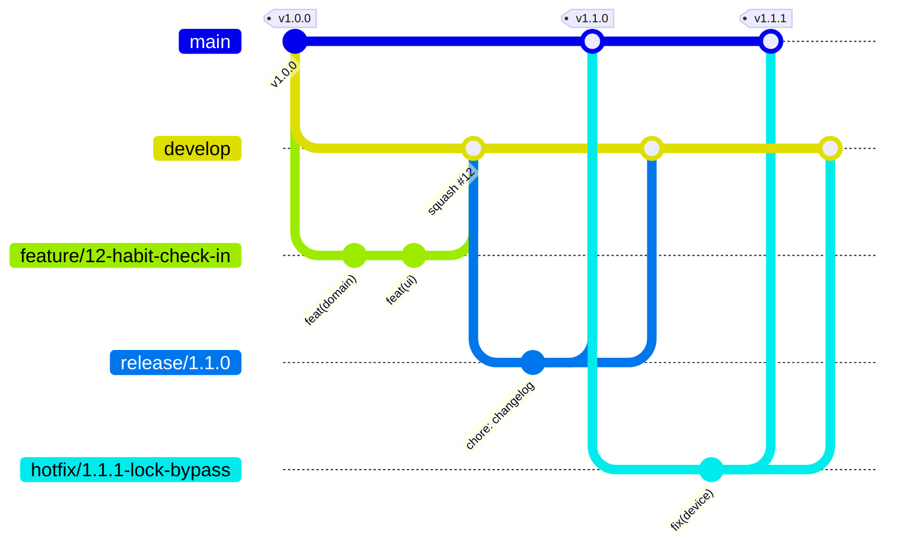

# Workflow Ascent

Inspiré de la [BMad Method](https://github.com/bmad-code-org/BMAD-METHOD). GitHub Issues est l'unique backlog. Le vocabulaire suit [`docs/glossary.md`](glossary.md).

## Principes

1. **Le propriétaire ne touche jamais au code.** Il définit les features et valide les stories. Tout le reste est automatique, jusqu'au merge dans `develop` puis à la release sur `main`.
2. **Une seule validation humaine** : les stories d'une épique, avant le développement.
3. **Les barrières de qualité remplacent la relecture humaine.** Une PR n'est mergée que si toutes sont au vert.
4. **Le glossaire est la source de vérité** du vocabulaire. Les docs, le code et les tests l'utilisent tel quel.
5. **Une story = une branche = une PR.**

## Schéma du flow



## Vue d'ensemble

```
 1. DEFINE      Propriétaire → Orchestrateur          → issue Epic
 2. SPECIFY     PM + Game Designer + UX               → stories + critères Gherkin + maquettes
                ✋ VALIDATION DU PROPRIÉTAIRE
 3. READY       Architect                             → notes techniques
 ──────────────────────── automatique ────────────────────────
 4. IMPACT      Impact Analyst (GitNexus)
                ├─ impact faible → 5
                └─ impact fort   → PM + Architect → retour en 2 ou 3
 5. IMPLEMENT   Dev                                   → code + tests (TDD)
 6. TEST        QA                                    → toutes les barrières
 7. REVIEW      Reviewer                              → OK → 8, sinon → 5
 8. MERGE       Auto-merge dans develop               → issue fermée
    RELEASE     Épique terminée → release/x.y.z → main (tag vx.y.z)
```

## Branches et worktrees

Le modèle de branches suit **Git Flow** (détails dans « CI/CD et Git Flow »). Le nom de la branche dit **ce qu'on fait**, et le worktree porte le même nom que la branche.

### Branches permanentes

| Branche | Rôle | Qui y écrit |
|---|---|---|
| `main` | Ce qui est publié. Chaque commit est une version taguée `vX.Y.Z`. | Uniquement les merges de `release/*` et `hotfix/*` |
| `develop` | Intégration : la prochaine version en préparation. | Uniquement les PR de `feature/*`, `bugfix/*`, `chore/*`, `docs/*` |

Personne, agent compris, ne pousse directement sur `main` ou `develop`.

### Branches de travail

| Type | Format | Part de | Merge dans | Exemple |
|---|---|---|---|---|
| Feature (story) | `feature/<n°>-<slug>` | `develop` | `develop` (squash) | `feature/12-habit-check-in` |
| Bugfix (bug sur `develop`) | `bugfix/<n°>-<slug>` | `develop` | `develop` (squash) | `bugfix/31-xp-counted-twice` |
| Hotfix (bug en production) | `hotfix/<x.y.z>-<slug>` | `main` | `main` + `develop` | `hotfix/1.2.1-lock-bypass` |
| Release | `release/<x.y.z>` | `develop` | `main` + `develop` | `release/1.3.0` |
| Outillage, CI | `chore/<slug>` | `develop` | `develop` (squash) | `chore/setup-quality-gates` |
| Documentation | `docs/<slug>` | `develop` | `develop` (squash) | `docs/clarify-skill-rules` |

### Règles de nommage

- Minuscules, mots séparés par des **tirets**. Pas d'espaces, d'underscores, d'accents ni de majuscules.
- Le préfixe correspond au type de travail ; il est cohérent avec le type Conventional Commits du titre de la PR (`feature/` → `feat`, `bugfix/` et `hotfix/` → `fix`).
- Le **numéro d'issue** suit le préfixe dès qu'il existe une issue.
- Le slug est **court** (3 à 5 mots, en anglais, comme le code) et **descriptif**. Pas de nom de personne ni de mot vague comme `update`, `test` ou `wip`.
- Une branche, un worktree, une PR. La branche est supprimée après le merge.
- Si le travail change de nature, l'orchestrateur renomme la branche (et le worktree) avant d'ouvrir la PR. Une branche au nom générique est renommée dès que l'on sait ce qu'on y fait.

## Messages de commit

Les commits suivent [Conventional Commits 1.0.0](https://www.conventionalcommits.org/en/v1.0.0/).

```
<type>(<scope>): <description>

[corps facultatif]

[footers facultatifs]
```

- **Description** : en anglais, à l'impératif, en minuscules, sans point final, 72 caractères au plus (ex. `feat(domain): award xp on habit check-in`). Les termes viennent du glossaire (nom de code entre parenthèses).
- **Corps** : le *pourquoi* du changement, si ce n'est pas évident.
- **Footers** : `Refs: #<n°>` pour l'issue. `BREAKING CHANGE: <explication>` pour un changement incompatible.

### Types

| Type | Usage | Version |
|---|---|---|
| `feat` | Nouvelle fonctionnalité pour le joueur | MINOR |
| `fix` | Correction d'un bug | PATCH |
| `refactor` | Restructuration sans changement de comportement | — |
| `perf` | Amélioration des performances | — |
| `test` | Ajout ou correction de tests uniquement | — |
| `docs` | Documentation, glossaire | — |
| `style` | Formatage, sans changement de code | — |
| `build` | Dépendances, configuration de build | — |
| `ci` | Pipelines et barrières de qualité | — |
| `chore` | Maintenance qui ne rentre dans aucun autre type | — |

Un `!` après le type ou le scope (ex. `feat(persistence)!: …`), ou un footer `BREAKING CHANGE:`, signale un changement incompatible (MAJOR). Par exemple : une migration qui ne permet pas de revenir en arrière.

### Scopes

Le scope indique la zone touchée, alignée sur l'architecture.

| Scope | Zone | Auteur |
|---|---|---|
| `domain` | `src/domain/` | dev |
| `application` | `src/application/` | dev |
| `persistence` | `src/adapters/persistence/` | dev |
| `ui` | `src/adapters/ui/` | dev |
| `device` | `src/adapters/device/` | dev |
| `app` | `src/app/`, configuration | dev |
| `e2e` | `e2e/` | dev |
| `glossary` | `docs/glossary.md` | tous |
| `workflow` | `docs/workflow.md`, agents, skills, templates | orchestrateur |

Le scope est facultatif quand un commit touche plusieurs zones.

### Commits et PR

- Le dev fait des commits **petits et atomiques**, un scope par commit.
- Les PR de feature et de bugfix sont mergées en **squash** dans `develop` : le **titre de la PR** devient le commit sur `develop`. Il doit donc lui aussi respecter le format, avec le type dominant de la story (ex. `feat: track daily habit check-ins`). Le corps du commit squashé contient `Closes #<n°>`.
- Le format est vérifié automatiquement (barrière **Commits** ci-dessous). C'est cet historique qui sert à calculer le numéro de version et à générer le changelog de chaque release.

## Statuts (labels GitHub)

| Label | Étape | Qui fait avancer |
|---|---|---|
| `status:idea` | 1. Define | Orchestrateur |
| `status:specifying` | 2. Specify | PM, Game Designer, UX |
| `status:awaiting-approval` | ✋ Validation | **Propriétaire** |
| `status:ready` | 3. Ready | Architect |
| `status:impact-analysis` | 4. Impact | Impact Analyst |
| `status:in-progress` | 5–6. Implement + Test | Dev (ou Fixer pour un bug), QA |
| `status:review` | 7. Review | Reviewer |
| `status:blocked` | Escalade | **Propriétaire** |
| *(issue fermée)* | 8. Merge | Auto |

Labels de type : `type:epic`, `type:story`, `type:bug`, `type:chore`.

## Les étapes en détail

### 1. Define — `/define-feature`
Le propriétaire décrit la feature dans le chat. L'orchestrateur crée une issue `type:epic` à partir du template [epic](../.github/ISSUE_TEMPLATE/epic.md) : objectif, valeur pour le joueur, périmètre, hors périmètre. Tout nouveau terme est ajouté au glossaire.

### 2. Specify — `/split-stories`
- **PM** : découpe l'épique en stories (sous-issues), chacune livrable et testable seule.
- **Game Designer** : règles de jeu, barèmes, équilibrage.
- **UX** : parcours et **maquettes** des écrans (voir « Maquettes » ci-dessous).
- Les critères d'acceptation sont écrits en **Gherkin** et deviendront des tests exécutables.
- Le statut passe à `status:awaiting-approval`. L'orchestrateur résume les stories au propriétaire et lui donne le lien vers les maquettes.

**✋ Le propriétaire valide les stories et les maquettes.** Sans validation, rien ne part en développement.

#### Maquettes

Toute épique avec une partie visible par le joueur a des maquettes, validées par le propriétaire **en même temps** que les stories.

- **Format** : une page HTML statique par épique, `docs/mockups/<n°-épique>-<slug>/index.html`, autonome (sans dépendance externe), qui montre chaque écran dans un cadre de téléphone.
- **Contenu** : chaque écran de chaque story, avec **tous ses états** (vide, chargement, erreur, succès, première utilisation) et le **feedback de jeu** (gain d'expérience, montée de niveau, déblocage). Les vrais libellés, tirés du glossaire, pas de faux texte. Chaque écran est annoté avec le numéro de la story qu'il illustre.
- **Consultation** : l'orchestrateur publie la page en lien privé, consultable sur téléphone, et met ce lien dans l'issue épique et dans le résumé de validation.
- **Itérations** : les retours du propriétaire produisent une nouvelle version de la maquette, jusqu'à validation.
- **Après validation** : la maquette est committée sur une branche `docs/<n°-épique>-mockups`, mergée dans `develop`. Elle **fait foi** pour l'interface : le dev la reproduit, et le Reviewer compare les captures d'écran de la PR avec elle.
- Une maquette ne fixe pas de choix technique. Les premières maquettes posent l'identité visuelle (couleurs, typographie, composants) que les suivantes réutilisent.

### 3. Ready
L'**Architect** ajoute les notes techniques à chaque story : couches hexagonales touchées, ports et adaptateurs, données, risques.

### 4. Impact — analyse GitNexus
Avant toute ligne de code, l'**Impact Analyst** indexe le dépôt avec GitNexus et mesure ce que la story va toucher.

L'impact est **fort** si au moins un de ces points est vrai :
- un changement de modèle de données stockées (migration) ;
- une modification d'un port ou d'une règle du domaine utilisée par d'autres features ;
- plus de 10 fichiers existants modifiés, ou plus de 2 modules touchés ;
- une contradiction avec une autre story ouverte ou avec le glossaire.

Si l'impact est fort, la story revient au **PM** et à l'**Architect**, qui la redécoupent ou l'ajustent. La décision est tracée en commentaire sur l'issue. Si ce changement modifie ce que le propriétaire a validé, la story repasse par ✋.

### 5. Implement — `/dev-story`
Un seul agent, le **Dev** (full stack), implémente toute la story sur la branche `feature/<n°>-<slug>` et une PR vers `develop`. Il travaille en TDD et respecte l'architecture hexagonale.

Il possède toutes les couches : `domain`, `application`, `adapters/persistence` (règles de jeu, cas d'usage, ports, base locale, migrations ; plus tard API et serveur), `adapters/ui` (composants, design system, écrans, états, feedback de jeu, accessibilité), `adapters/device` (biométrie, stockage sécurisé, notifications…), `app` (navigation, assemblage), configuration, builds et tests end-to-end.

- Il avance de l'intérieur vers l'extérieur : domaine et cas d'usage, persistance, interface, puis assemblage et end-to-end.
- Il ouvre la PR en **brouillon** après son premier commit et la sort du brouillon quand les barrières sont vertes en local.
- Un besoin hors du périmètre de la story se signale à l'orchestrateur.

### 6. Test
Le **QA** fait passer toutes les barrières de qualité ci-dessous, en local puis en CI.

### 7. Review — `/review-story`
Le **Reviewer** vérifie la PR par rapport aux critères d'acceptation, à l'architecture, au glossaire et aux rapports (coverage, mutation, Sonar). S'il y a un problème, retour en 5 avec des commentaires précis.

### 8. Merge
Quand toutes les barrières et la review sont au vert, la PR est mergée automatiquement dans `develop` (squash). Elle porte `Closes #<story>`. L'épique est fermée quand toutes ses stories le sont, ce qui déclenche une release (voir « CI/CD et Git Flow »).

## Barrières de qualité

Toutes sont **bloquantes**. Les outils sont confirmés par l'Architect dans l'[ADR 0001](adr/0001-socle-technique.md), qui liste aussi les écarts temporaires. En local, `npm run verify` exécute toutes les barrières sauf la mutation et l'end-to-end ; `npm run verify:full` y ajoute la mutation, sans les écrans (voir la barrière 9).

| # | Barrière | Ce qu'elle garantit | Outil | Quand |
|---|---|---|---|---|
| 1 | **Secrets** | Aucun secret ne part dans le dépôt | Gitleaks | pre-commit + CI |
| 1 bis | **Commits** | Messages de commit et titre de PR au format Conventional Commits | commitlint | commit-msg + CI |
| 2 | **Style** | Formatage et style uniformes | Prettier + ESLint (dont la règle de pureté du domaine et des cas d'usage) | pre-commit + CI |
| 3 | **Types** | Pas d'erreur de typage | TypeScript (`tsc --noEmit`) | pre-commit + CI |
| 4 | **Architecture** | Les dépendances respectent l'hexagonal (équivalent d'ArchUnit) | dependency-cruiser | local + CI |
| 5 | **Tests unitaires** | Domaine et cas d'usage | Jest | CI |
| 6 | **Tests d'intégration** | Adaptateurs + base locale + écrans | Jest + React Native Testing Library | CI |
| 7 | **Tests BDD** | Les critères d'acceptation Gherkin passent | Cucumber (`jest-cucumber`) | CI |
| 8 | **Tests end-to-end** | Parcours réels sur l'app | Maestro (mobile) ; Playwright si une version web apparaît | CI |
| 9 | **Tests de mutation** | Les tests détectent vraiment les bugs. Les **écrans** (`src/adapters/ui/`, `src/app/`) ne sont mutés qu'à la demande du propriétaire (voir « Mutation des écrans à la demande ») | StrykerJS | CI |
| 10 | **Coverage et qualité** | Seuils de couverture, code smells, duplication, sécurité | SonarQube Cloud | CI |
| 10 bis | **Conformité aux maquettes** | Les écrans livrés correspondent aux maquettes validées (captures d'écran des tests end-to-end jointes à la PR) | Revue (Reviewer) | Review |
| 11 | **Glossaire** | Les termes nouveaux ou modifiés figurent dans `docs/glossary.md` | Revue (Reviewer) | Review |

### Seuils (ajustables)

| Mesure | Seuil |
|---|---|
| Coverage du code nouveau | ≥ 80 % |
| Coverage du domaine | ≥ 95 % |
| Score de mutation du code nouveau | ≥ 70 % |
| Score de mutation du domaine | ≥ 85 % |
| Quality gate SonarQube Cloud | Passed |
| Duplication du code nouveau | ≤ 3 % |

> Le score du code nouveau est calculé sur l'ensemble des mutants des lignes ajoutées ou modifiées hors domaine, tous jobs confondus. Le score du domaine porte sur les fichiers du domaine modifiés (PR) ou sur tout le domaine (release). Voir l'[ADR 0004](adr/0004-mutation-en-ci.md).
>
> Par défaut, la mutation porte sur `src/domain/`, `src/application/`, `src/adapters/persistence/` et `src/adapters/device/`. Les écrans n'entrent dans le score du code nouveau que lorsque leur mutation est demandée ; les seuils sont alors les mêmes.

### Mutation des écrans à la demande

Décision du propriétaire du 22 octobre 2026 (issue #54, avenant à l'[ADR 0004](adr/0004-mutation-en-ci.md)) : la mutation des **écrans** (`src/adapters/ui/` et `src/app/`) est trop longue pour chaque story. Elle ne tourne que dans trois cas :

| Cas | Comment | Ce qui est muté |
|---|---|---|
| **PR** | L'orchestrateur pose le label `mutation:ui` sur la PR, quand le propriétaire le demande. | À la pose du label, les lignes nouvelles des écrans (workflow `Screen mutation`) ; à chaque push suivant, le code nouveau écrans compris (CI). |
| **Lancement manuel de la CI** | `workflow_dispatch` du workflow `CI` avec l'entrée `ui-mutation` cochée. | Tout le code, écrans compris. |
| **En local** | `npm run mutation:ui` (lignes nouvelles depuis `origin/develop`) ; `npm run mutation:ui -- --full` pour tous les écrans. | Les écrans seuls. |

Quand elle tourne, les seuils actuels s'appliquent (code nouveau : 70 %). Sinon, le résumé de la CI l'indique : « Screen mutation (…) not requested ». Ni les agents ni la review n'exigent la mutation des écrans quand elle n'a pas été demandée.

Règles pour l'orchestrateur :

- Il ne pose `mutation:ui` que si le propriétaire le demande, jamais de sa propre initiative.
- Le check `Screen mutation tests (StrykerJS)` n'existe que sur le commit où le label a été posé : il ne peut pas être exigé par la protection de branche, et l'auto-merge ne l'attend pas. Quand `mutation:ui` est posé, l'orchestrateur attend donc que ce check soit **vert** avant d'activer l'auto-merge ; si l'auto-merge était déjà actif, il le désactive jusque-là. Un check rouge renvoie au dev, comme une barrière rouge. Aux pushs suivants, la mutation des écrans est comptée dans le check habituel `Mutation tests (StrykerJS)`, déjà exigé.
- Cas limite accepté : une PR **créée** avec le label déjà posé mute ses écrans deux fois (par la CI et par le workflow `Screen mutation`, que GitHub déclenche aussi à la création). Les deux résultats doivent être verts.

## Architecture hexagonale

```
src/
  domain/                 règles métier pures — aucune dépendance externe
  application/            cas d'usage + ports (interfaces)
  adapters/
    persistence/          stockage local, migrations
    ui/                   composants, écrans, état d'affichage
    device/               biométrie, stockage sécurisé, notifications…
  app/                    routes et assemblage
e2e/                      tests end-to-end
```

Règles vérifiées par les tests d'architecture :
- `domain` n'importe rien hors de `domain`.
- `application` n'importe que `domain`.
- `adapters` implémentent les ports de `application`. Un adaptateur n'importe pas un autre adaptateur (`ui` ne connaît ni `persistence` ni `device`).
- Seuls `adapters` et `app` connaissent le framework et les bibliothèques natives.
- `domain` et `application` n'utilisent ni minuteur, ni horloge directe, ni hasard (`setTimeout`, `setInterval`, `requestAnimationFrame`, `performance`, `Math.random`) : le temps et le hasard passent par des ports. Vérifié par ESLint (barrière Style).

Conséquence pour les tests : le domaine et les cas d'usage se testent en unitaire, sans framework. Les adaptateurs se testent en intégration. Les parcours complets se testent en BDD et en end-to-end.

## CI/CD et Git Flow



### Pipelines

| Déclencheur | Ce qui tourne | Résultat |
|---|---|---|
| **PR vers `develop`** (`feature/`, `bugfix/`, `chore/`, `docs/`) | Toutes les barrières de qualité : commits, secrets, style, types, architecture, unitaires, intégration, BDD, mutation sur le code nouveau hors écrans (lignes ajoutées ou modifiées ; fichiers du domaine modifiés en entier), en jobs parallèles, écrans compris seulement avec le label `mutation:ui`, SonarQube Cloud. End-to-end sur une plateforme. | Auto-merge (squash) si tout est vert et la review approuvée |
| **Push sur `develop`** | Les mêmes barrières sur le résultat du merge, sauf la mutation (déjà faite par la PR), puis un **build de preview** installable sur le téléphone du propriétaire | Le propriétaire peut essayer la prochaine version |
| **Branche `release/x.y.z`** | Suite complète : end-to-end **iOS et Android**, mutation sur tout le code hors écrans, SonarQube Cloud. Génération du changelog. Build de production. | Merge dans `main` si tout est vert |
| **Merge sur `main`** | Tag `vX.Y.Z`, GitHub Release avec le changelog, build de production distribué | Nouvelle version publiée |
| **Branche `hotfix/x.y.z-…`** | Suite complète, comme une release (mutation hors écrans) | Merge dans `main` (tag) puis dans `develop` |
| **Lancement manuel** (`workflow_dispatch`) | La CI complète ; mutation sur tout le code, écrans compris si l'entrée `ui-mutation` est cochée | À la demande du propriétaire |

Outils : GitHub Actions pour les pipelines **et** les builds. Chaque push produit un APK Android en artefact (le build de preview sur `develop`) ; chaque tag `vX.Y.Z` attache l'APK à la GitHub Release. EAS Build et EAS Update ne sont pas retenus pour l'instant (voir l'[ADR 0001](adr/0001-socle-technique.md)).

Conservation des artefacts (stockage GitHub Actions limité) : l'APK est gardé **1 jour** sur une PR, **7 jours** sur `develop` et **30 jours** sur `main`, `release/*` et `hotfix/*` ; les rapports de couverture, de mutation et d'end-to-end **7 jours**. Le job `Clean up old artifacts` (`scripts/ci/cleanup-artifacts.mjs`), sur chaque PR du dépôt et chaque push sur `develop`, supprime les APK devenus inutiles : il garde le plus récent de `develop`, de `main`, de chaque `release/*` et `hotfix/*` et de chaque branche qui a une PR ouverte, jamais celui d'une PR venant d'un fork. Il ne fait jamais échouer la CI. Le job `e2e-android` met aussi en cache l'image système de l'émulateur (clé `android-system-image-<API>-<cible>-<architecture>-v<N>`, environ **1,5 Go** par portée de cache, sur un quota de **10 Go** par dépôt) ; elle n'est retéléchargée, avec trois tentatives, que si le cache manque.

### Releases

- Une release est déclenchée **automatiquement**, sans validation du propriétaire, par l'orchestrateur **quand une épique est terminée**. Le propriétaire peut aussi en demander une à tout moment.
- Le numéro de version est calculé à partir des commits Conventional Commits depuis la dernière version : `BREAKING CHANGE` → MAJOR, `feat` → MINOR, `fix` → PATCH.
- La branche `release/x.y.z` ne reçoit que la préparation de la version (changelog, numéro de version) et des corrections de bugs trouvés pendant la release, jamais de nouvelle fonctionnalité.
- `release/*` et `hotfix/*` sont mergées dans `main` avec un **commit de merge** (pas de squash), pour garder l'historique, puis réintégrées dans `develop`.
- Le propriétaire reçoit un résumé produit de la version : ce qui est nouveau pour le joueur.

### Protection des branches

- `main` et `develop` sont protégées : pas de push direct, pas de force-push, toutes les barrières de qualité obligatoires.
- `develop` n'accepte que le squash ; `main` n'accepte que des merges venant de `release/*` ou `hotfix/*`.
- Les branches de travail sont supprimées automatiquement après le merge.

## Boucles et escalade

- **Review → Implement** : 3 tours au maximum. Au 4e échec, la story passe en `status:blocked` et l'orchestrateur résume le problème en commentaire sur l'issue au propriétaire.
- **Barrière rouge sur `develop`** : priorité absolue, une issue `type:bug` est créée et traitée en `bugfix/` immédiatement avec `/fix-bug`.
- **Bug en production (`main`)** : une issue `type:bug` avec le label `priority:hotfix` est traitée en `hotfix/` avec `/fix-bug`, en dehors du flux normal (voir « CI/CD et Git Flow »).

## Bugs — `/fix-bug`

Un bug n'est pas une story : il ne crée pas de comportement nouveau, il rétablit celui que le propriétaire a déjà validé. Il ne repasse donc pas par ✋ et part directement en `status:ready`.

1. L'issue `type:bug` (template « Bug ») décrit les étapes pour reproduire, l'attendu et l'observé.
2. Le **Fixer** écrit d'abord un test de non-régression qui échoue, trouve la cause racine et applique la correction minimale, sur `bugfix/<n°>-<slug>` (depuis `develop`) ou `hotfix/<x.y.z>-<slug>` (depuis `main`).
3. Les étapes **Test** (QA) et **Review** (Reviewer) sont les mêmes que pour une story, avec les mêmes barrières et la même limite de 3 tours.
4. Si la correction change une règle de jeu ou un écran validés, ce n'est plus un bug mais un changement de périmètre : PM et Architect, puis ✋. Si elle demande une migration ou touche un port partagé, l'Impact Analyst et l'Architect passent avant le Fixer.
- **Impact fort** : décision du PM et de l'Architect, tracée sur l'issue. Le propriétaire n'est sollicité que si ce qu'il a validé change.

## Agents et skills

| Agent | Fichier | Étapes |
|---|---|---|
| Orchestrateur | `CLAUDE.md` (session principale) | Toutes |
| PM | `.claude/agents/pm.md` | 2, escalade d'impact |
| Game Designer | `.claude/agents/game-designer.md` | 2 |
| UX | `.claude/agents/ux.md` | 2 |
| Architect | `.claude/agents/architect.md` | 3, escalade d'impact |
| Impact Analyst | `.claude/agents/impact-analyst.md` | 4 |
| Dev | `.claude/agents/dev.md` | 5 |
| Fixer | `.claude/agents/fixer.md` | Bugs (`/fix-bug`) |
| QA | `.claude/agents/qa.md` | 6 |
| Reviewer | `.claude/agents/reviewer.md` | 7 |

| Skill | Rôle |
|---|---|
| `/backlog` | Récupère les issues ouvertes et propose la suite |
| `/define-feature` | Étape 1 |
| `/split-stories` | Étape 2 |
| `/dev-story` | Étapes 3 à 8 pour une story `status:ready` |
| `/fix-bug` | Correction d'un bug (`bugfix/` ou `hotfix/`) |
| `/review-story` | Étape 7 sur une PR |
| `/release` | Release ou hotfix selon Git Flow |
