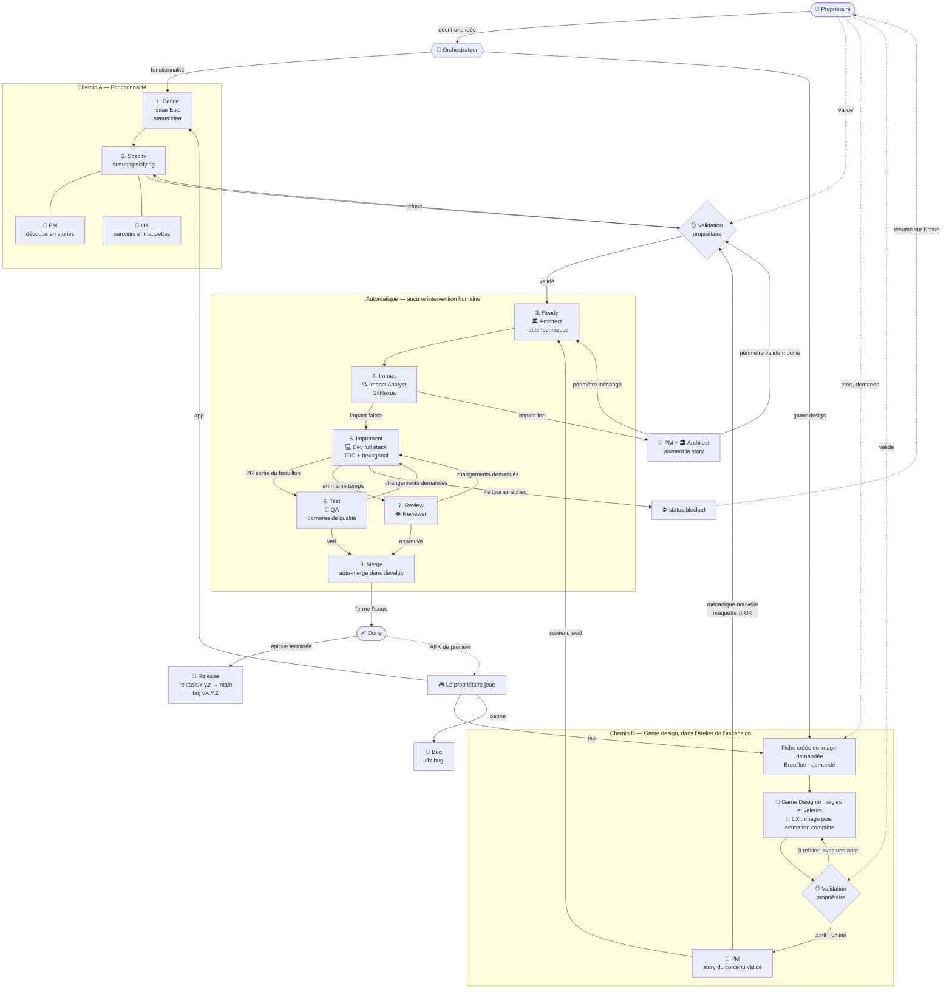
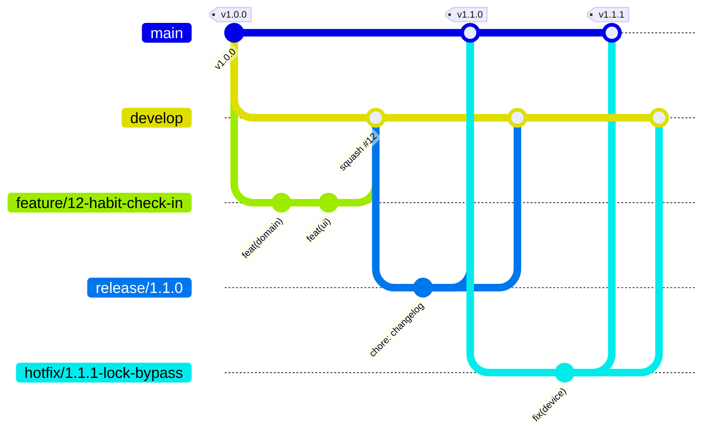

# Workflow Ascent

Inspiré de la [BMad Method](https://github.com/bmad-code-org/BMAD-METHOD). GitHub Issues est l'unique backlog. Le vocabulaire suit [`docs/glossary.md`](glossary.md).

## Principes

1. **Le propriétaire ne touche jamais au code.** Il décrit ses idées, valide les stories et, dans l'Atelier de l'ascension, le contenu du jeu. Tout le reste est automatique, jusqu'au merge dans `develop` puis à la release sur `main`.
2. **Deux chemins pour une idée** (décision du propriétaire du 28/10/2026). Une **fonctionnalité** (une partie de l'app, sans contenu de jeu) suit le **chemin A** : épique, maquette, stories. Le **game design** (contenu et gameplay : créature, arme, bienfait, mécanique, valeurs) suit le **chemin B** : tout passe par l'Atelier de l'ascension. Les deux chemins se rejoignent à l'étape 3 (Ready).
3. **Rien ne part en développement sans validation du propriétaire** : les stories et la maquette d'une épique sur le chemin A ; la fiche, l'image et l'animation dans l'Atelier sur le chemin B.
4. **Les barrières de qualité remplacent la relecture humaine.** Une PR n'est mergée que si toutes sont au vert.
5. **Le glossaire est la source de vérité** du vocabulaire. Les docs, le code et les tests l'utilisent tel quel.
6. **Une story = une branche = une PR.**
7. **L'Atelier de l'ascension est la source de vérité du game design** : c'est la partie « métier », où le propriétaire, le Game Designer et l'UX travaillent ensemble (voir « Atelier de l'ascension » ci-dessous).

## Schéma du flow



## Vue d'ensemble

```
    IDÉE        Propriétaire → Orchestrateur, qui oriente l'idée
                ├─ une fonctionnalité de l'app      → chemin A
                └─ du contenu ou du gameplay       → chemin B
 ─────────────── chemin A : fonctionnalité ───────────────
 1. DEFINE      Orchestrateur                         → issue Epic
 2. SPECIFY     PM + UX                               → stories + critères Gherkin + maquettes
                ✋ VALIDATION DU PROPRIÉTAIRE
 ─────────────── chemin B : game design (Atelier) ───────────────
    ATELIER     Propriétaire                          → fiche en Brouillon ou image demandée
                Game Designer + UX                    → règles et valeurs, image puis animation complète
                ✋ LE PROPRIÉTAIRE VALIDE, ou renvoie « à refaire » avec une note (en boucle)
                PM                                    → story du contenu validé
                (mécanique nouvelle : maquette UX et ✋ validation de la story)
 ─────────────── les deux chemins se rejoignent ───────────────
 3. READY       Architect                             → notes techniques
 ──────────────────────── automatique ────────────────────────
 4. IMPACT      Impact Analyst (GitNexus)
                ├─ impact faible → 5
                └─ impact fort   → PM + Architect → retour en 2 ou 3
 5. IMPLEMENT   Dev                                   → code + tests (TDD)
 6. TEST     ┐  QA        (en parallèle, lecture seule) → toutes les barrières
 7. REVIEW   ┘  Reviewer  (en parallèle, lecture seule) → les deux verts → 8, sinon → 5
 8. MERGE       Auto-merge dans develop               → issue fermée
    RETOURS     Le propriétaire joue : jeu → Atelier ; app → nouvelle épique ; panne → /fix-bug
    RELEASE     Épique terminée → release/x.y.z → main (tag vx.y.z)
```

## Branches et worktrees

Le modèle de branches suit **Git Flow** (détails dans « CI/CD et Git Flow »). Le nom de la branche dit **ce qu'on fait**, et le worktree porte le même nom que la branche.

### Branches permanentes

| Branche | Rôle | Qui y écrit |
|---|---|---|
| `main` | Ce qui est publié. Chaque commit est une version taguée `vX.Y.Z`. | Uniquement les merges de `release/*` et `hotfix/*` |
| `develop` | Intégration : la prochaine version en préparation. | Uniquement les PR de `feature/*`, `bugfix/*`, `chore/*`, `docs/*` |

Personne, agent compris, ne pousse directement sur `main` ou `develop`.

### Branches de travail

| Type | Format | Part de | Merge dans | Exemple |
|---|---|---|---|---|
| Feature (story) | `feature/<n°>-<slug>` | `develop` | `develop` (squash) | `feature/12-habit-check-in` |
| Bugfix (bug sur `develop`) | `bugfix/<n°>-<slug>` | `develop` | `develop` (squash) | `bugfix/31-xp-counted-twice` |
| Hotfix (bug en production) | `hotfix/<x.y.z>-<slug>` | `main` | `main` + `develop` | `hotfix/1.2.1-lock-bypass` |
| Release | `release/<x.y.z>` | `develop` | `main` + `develop` | `release/1.3.0` |
| Outillage, CI | `chore/<slug>` | `develop` | `develop` (squash) | `chore/setup-quality-gates` |
| Documentation | `docs/<slug>` | `develop` | `develop` (squash) | `docs/clarify-skill-rules` |

### Règles de nommage

- Minuscules, mots séparés par des **tirets**. Pas d'espaces, d'underscores, d'accents ni de majuscules.
- Le préfixe correspond au type de travail ; il est cohérent avec le type Conventional Commits du titre de la PR (`feature/` → `feat`, `bugfix/` et `hotfix/` → `fix`).
- Le **numéro d'issue** suit le préfixe dès qu'il existe une issue.
- Le slug est **court** (3 à 5 mots, en anglais, comme le code) et **descriptif**. Pas de nom de personne ni de mot vague comme `update`, `test` ou `wip`.
- Une branche, un worktree, une PR. La branche est supprimée après le merge.
- Si le travail change de nature, l'orchestrateur renomme la branche (et le worktree) avant d'ouvrir la PR. Une branche au nom générique est renommée dès que l'on sait ce qu'on y fait.

## Messages de commit

Les commits suivent [Conventional Commits 1.0.0](https://www.conventionalcommits.org/en/v1.0.0/).

```
<type>(<scope>): <description>

[corps facultatif]

[footers facultatifs]
```

- **Description** : en anglais, à l'impératif, en minuscules, sans point final, 72 caractères au plus (ex. `feat(domain): award xp on habit check-in`). Les termes viennent du glossaire (nom de code entre parenthèses).
- **Corps** : le *pourquoi* du changement, si ce n'est pas évident.
- **Footers** : `Refs: #<n°>` pour l'issue. `BREAKING CHANGE: <explication>` pour un changement incompatible.

### Types

| Type | Usage | Version |
|---|---|---|
| `feat` | Nouvelle fonctionnalité pour le joueur | MINOR |
| `fix` | Correction d'un bug | PATCH |
| `refactor` | Restructuration sans changement de comportement | — |
| `perf` | Amélioration des performances | — |
| `test` | Ajout ou correction de tests uniquement | — |
| `docs` | Documentation, glossaire | — |
| `style` | Formatage, sans changement de code | — |
| `build` | Dépendances, configuration de build | — |
| `ci` | Pipelines et barrières de qualité | — |
| `chore` | Maintenance qui ne rentre dans aucun autre type | — |

Un `!` après le type ou le scope (ex. `feat(persistence)!: …`), ou un footer `BREAKING CHANGE:`, signale un changement incompatible (MAJOR). Par exemple : une migration qui ne permet pas de revenir en arrière.

### Scopes

Le scope indique la zone touchée, alignée sur l'architecture.

| Scope | Zone | Auteur |
|---|---|---|
| `domain` | `src/domain/` | dev |
| `application` | `src/application/` | dev |
| `persistence` | `src/adapters/persistence/` | dev |
| `ui` | `src/adapters/ui/` | dev |
| `device` | `src/adapters/device/` | dev |
| `app` | `src/app/`, configuration | dev |
| `e2e` | `e2e/` | dev |
| `glossary` | `docs/glossary.md` | tous |
| `workflow` | `docs/workflow.md`, agents, skills, templates | orchestrateur |
| `release` | numéro de version et changelog d'une release (`chore(release): x.y.z`) | orchestrateur |

Le scope est facultatif quand un commit touche plusieurs zones.

### Commits et PR

- Le dev fait **un commit par couche** (voir « TDD par couche »), atomique et avec un seul scope : environ 4 à 6 commits par story. Les corrections demandées par le QA ou le Reviewer se font en commits séparés.
- Les PR de feature et de bugfix sont mergées en **squash** dans `develop` : le **titre de la PR** devient le commit sur `develop`. Il doit donc lui aussi respecter le format, avec le type dominant de la story (ex. `feat: track daily habit check-ins`). Le corps du commit squashé contient `Closes #<n°>`.
- Le format est vérifié automatiquement (barrière **Commits** ci-dessous). C'est cet historique qui sert à calculer le numéro de version et à générer le changelog de chaque release.

## Statuts (labels GitHub)

| Label | Étape | Qui fait avancer |
|---|---|---|
| `status:idea` | 1. Define | Orchestrateur |
| `status:specifying` | 2. Specify (chemin A) | PM, UX (Game Designer pour une règle de jeu hors du Codex) |
| `status:awaiting-approval` | ✋ Validation des stories (chemin A, ou mécanique nouvelle du chemin B) | **Propriétaire** |
| `status:ready` | 3. Ready, où les deux chemins se rejoignent | Architect |
| `status:impact-analysis` | 4. Impact | Impact Analyst |
| `status:in-progress` | 5. Implement, et chaque correction demandée par le QA ou le Reviewer | Dev (ou Fixer pour un bug) |
| `status:review` | 6–7. Test et Review, en parallèle | QA et Reviewer |
| `status:blocked` | Escalade | **Propriétaire** |
| *(issue fermée)* | 8. Merge | Auto |

Le travail dans l'Atelier (fiches, images, animations) ne porte pas de label : il vit dans l'Atelier, jusqu'à la story.

Labels de type : `type:epic`, `type:story`, `type:bug`, `type:chore`.

Labels de mode, sur une story ou une PR : `prototype` (voir « Mode prototype ») et `mutation:ui` (voir « Mutation des écrans à la demande »).

## Les étapes en détail

### Orienter une idée

Le propriétaire décrit son idée dans le chat. L'orchestrateur l'oriente selon ce qu'elle touche :

- une **fonctionnalité** (une partie de l'app sans contenu de jeu : un écran, des boutons, le suivi des habitudes…) → **chemin A**, étapes 1 et 2 ;
- du **game design** (contenu et gameplay : une créature, une arme, un bienfait, une mécanique de combat, des valeurs) → **chemin B**, dans l'**Atelier de l'ascension** (voir ci-dessous). Il ne passe ni par `/define-feature` ni par `/split-stories`.

En cas de doute, l'orchestrateur pose la question au propriétaire. Une idée qui touche les deux se sépare : le contenu va dans l'Atelier, la partie de l'app devient une épique.

### 1. Define — `/define-feature` (chemin A)
L'orchestrateur crée une issue `type:epic` à partir du template [epic](../.github/ISSUE_TEMPLATE/epic.md) : objectif, valeur pour le joueur, périmètre, hors périmètre. Tout nouveau terme est ajouté au glossaire.

### 2. Specify — `/split-stories` (chemin A)
- **PM** : découpe l'épique en stories (sous-issues), selon les règles de « Découpage en stories » ci-dessous.
- **UX** : parcours et **maquettes** des écrans (voir « Maquettes » ci-dessous).
- **Game Designer** : seulement si l'épique touche une règle de jeu hors du Codex (expérience, progression du personnage) ; jamais sur une fonctionnalité pure. Le contenu du Codex passe par le chemin B.
- Les critères d'acceptation sont écrits en **Gherkin** et deviendront des tests exécutables.
- Le statut passe à `status:awaiting-approval`. L'orchestrateur résume les stories au propriétaire et lui donne le lien vers les maquettes.

**✋ Le propriétaire valide les stories et les maquettes.** Sans validation, rien ne part en développement.

#### Découpage en stories

Chaque story repasse par toutes les étapes et toutes les barrières de qualité. Des stories qui s'attendent les unes les autres font donc attendre l'épique entière. Le découpage suit cinq règles :

1. **Une story est visible et autonome.** Elle livre quelque chose de visible pour le joueur, et elle ne dépend du code d'aucune autre story pas encore mergée, sauf de la story socle de son épique (règle 3).
2. **Pas de chaîne entre stories.** Si une story B a besoin du code d'une story A, A et B ne forment qu'une seule story. La seule exception est la story socle.
3. **Une story socle au plus par épique.** Quand plusieurs stories ont besoin du même code et que les fondre en une seule donnerait une story trop grosse, ce code devient une **story socle**, développée en premier. Les autres stories de l'épique ne dépendent que du socle, jamais entre elles : elles démarrent une fois le socle mergé et se développent en parallèle. Le socle livre lui aussi quelque chose de visible pour le joueur. Une épique n'est pas coupée en deux pour éviter un socle.
4. **Seules les stories indépendantes se préparent à l'avance.** Les notes techniques (Ready) et l'analyse d'impact (Impact) ne sont préparées à l'avance que pour des stories indépendantes entre elles. Les stories qui dépendent du socle se préparent une fois le socle mergé.
5. **Une épique compte en général 2 à 3 stories, 4 avec une story socle.** Au-delà, elle est probablement trop grosse : elle se coupe en deux épiques.

Exemple : l'épique #22 a été découpée en 5 stories chaînées (#23 seule ; #24 avant #25 et #26 ; #26 avant #27). Avec ces règles, elle en aurait compté 3 : la **difficulté** (#23) ; l'**objectif hebdomadaire** et l'habitude dont l'**objectif de la semaine** est atteint qui ne compte plus comme manquée (#24 + #25) ; la prime d'expérience de l'**objectif atteint** et son affichage dans la **Vue Mois** (#26 + #27). Ces règles valent pour les épiques découpées à partir de maintenant : les stories déjà validées de #22 restent telles quelles.

#### Maquettes

Toute épique du chemin A avec une partie visible par le joueur a des maquettes, validées par le propriétaire **en même temps** que les stories. Sur le chemin B, une maquette n'est faite que pour une mécanique nouvelle ; l'image et l'animation du contenu sont validées dans l'Atelier.

- **Format** : une page HTML statique par épique, `docs/mockups/<n°-épique>-<slug>/index.html`, autonome (sans dépendance externe), qui montre chaque écran dans un cadre de téléphone.
- **Contenu** : chaque écran de chaque story, avec **tous ses états** (vide, chargement, erreur, succès, première utilisation) et le **feedback de jeu** (gain d'expérience, montée de niveau, déblocage). Les vrais libellés, tirés du glossaire, pas de faux texte. Chaque écran est annoté avec le numéro de la story qu'il illustre.
- **Consultation** : l'orchestrateur publie la page en lien privé, consultable sur téléphone, et met ce lien dans l'issue épique et dans le résumé de validation.
- **Itérations** : les retours du propriétaire produisent une nouvelle version de la maquette, jusqu'à validation.
- **Après validation** : la maquette est committée sur une branche `docs/<n°-épique>-mockups`, mergée dans `develop`. Elle **fait foi** pour l'interface : le dev la reproduit, et le Reviewer compare les captures d'écran de la PR avec elle.
- Une maquette ne fixe pas de choix technique. Les premières maquettes posent l'identité visuelle (couleurs, typographie, composants) que les suivantes réutilisent.

### Atelier de l'ascension (chemin B)

Décisions du propriétaire du 28/10/2026. L'**Atelier de l'ascension** (page publiée, source `docs/game-design/88-ascension-prototype.html`) est l'espace de travail commun du propriétaire, du Game Designer et de l'UX pour le contenu du jeu. Son **Codex** fait foi pour les ennemis, Élites, boss, héros, objets, bienfaits et bénédictions : stats, coups, effets, descriptions et assets. L'onglet **Équilibrage** rejoue la tour des centaines de fois avec les entrées Actives pour en vérifier les chiffres.

**La boucle de validation**

1. **Le propriétaire crée ou demande** : une nouvelle fiche (entrée en **Brouillon**), une image demandée avec une note (asset `demandé`), une valeur à changer.
2. **L'équipe propose.** Le **Game Designer** propose les règles, coups, valeurs et mécaniques, en Brouillon. L'**UX** propose l'image (asset `proposé`), puis, pour un ennemi, une Élite ou un boss, son **animation complète**.
3. **Le propriétaire valide**, ou renvoie « à refaire » avec une note : retour à l'étape 2, autant de fois que nécessaire. Il juge sur la fiche, l'image, l'animation et l'Équilibrage.
4. **Seul ce qu'il a validé devient une story** : une entrée **Active**, son image validée et, pour un ennemi, une Élite ou un boss, son animation complète validée. Le **PM** écrit la story à partir de l'Atelier. Si le contenu demande une **mécanique nouvelle** (un champ du Codex que le jeu ne sait pas encore jouer, comme Se relève seul ou le Saignement), l'UX fait une maquette et la story passe en `status:awaiting-approval` : le propriétaire la valide, comme une story du chemin A. Sinon, la validation dans l'Atelier suffit : la story part en `status:ready`.

**Règles**

- **Animation complète obligatoire.** Un ennemi, une Élite ou un boss n'entre en jeu qu'avec son **animation complète** validée dans l'Atelier, jamais avec une image fixe : les 17 poses du combat, les poses rouges s'il a un coup imparable, et les ancrages (voir « Animation complète » dans le glossaire). Un objet garde une image fixe.
- **Le Codex ne se branche pas au jeu.** Le jeu n'en lit aucun export : chaque contenu validé y entre par une story, codée par le dev à partir des valeurs du Codex.
- **Statuts** : seule une entrée **Active** est attendue dans le jeu. Un **Brouillon** est une idée en cours ; une entrée **Retirée** sort du jeu.
- **Du Codex à une story.** Quand le propriétaire valide un contenu (entrée passée en Active, entrée Active changée, image ou animation validée), l'orchestrateur relit la base de l'Atelier et compare le Codex au jeu. Chaque écart devient une story, rattachée à une épique de contenu en cours, ou à une nouvelle, créée par l'orchestrateur sans maquette ni `/split-stories`. La story cite le **nom de code** de chaque entrée et ses valeurs du Codex, recopiées au moment de la validation : ce sont elles que le dev code et que les tests vérifient.
- **Tests** : une story du chemin B n'a pas de test end-to-end propre. Ses règles se vérifient en tests unitaires du domaine, et l'Équilibrage de l'Atelier sert de contrôle (voir « Barrières de qualité »).
- **Le Game Designer** part du Codex. L'orchestrateur lui donne un instantané JSON de la base de l'Atelier. Il ne change jamais une entrée du propriétaire sans son accord : il propose ses changements en Brouillon, ou en commentaire sur l'épique.
- **L'orchestrateur** est le seul à écrire dans la base de l'Atelier, et seulement à la demande du propriétaire ou pour une proposition en Brouillon (règles du Game Designer, image ou animation de l'UX). Il ne modifie jamais une entrée Active sans son accord.

### 3. Ready
Les deux chemins se rejoignent ici. L'**Architect** ajoute les notes techniques à chaque story : couches hexagonales touchées, ports et adaptateurs, données, plan de test, risques. Le plan de test ne prévoit un end-to-end propre que pour une story du chemin A (voir la barrière 8).

### 4. Impact — analyse GitNexus
Avant toute ligne de code, l'**Impact Analyst** indexe le dépôt avec GitNexus et mesure ce que la story va toucher.

L'impact est **fort** si au moins un de ces points est vrai :
- un changement de modèle de données stockées (migration) ;
- une modification d'un port ou d'une règle du domaine utilisée par d'autres features ;
- une contradiction avec une autre story ouverte, avec le glossaire ou avec ce que le propriétaire a validé.

Le **volume** (nombre de fichiers existants modifiés, de modules ou de couches touchés) n'est **pas** un critère d'impact fort : une story full stack traverse normalement toutes les couches. Il reste signalé dans l'analyse comme **conseil de découpage en commits**, par exemple au-delà de 10 fichiers existants modifiés ou de 2 modules touchés.

Si l'impact est fort, la story revient au **PM** et à l'**Architect**, qui la redécoupent ou l'ajustent. La décision est tracée en commentaire sur l'issue. Si ce changement modifie ce que le propriétaire a validé, la story repasse par ✋.

### 5. Implement — `/dev-story`
Un seul agent, le **Dev** (full stack), implémente toute la story sur la branche `feature/<n°>-<slug>` et une PR vers `develop`. Il travaille en TDD et respecte l'architecture hexagonale.

Il possède toutes les couches : `domain`, `application`, `adapters/persistence` (règles de jeu, cas d'usage, ports, base locale, migrations ; plus tard API et serveur), `adapters/ui` (composants, design system, écrans, états, feedback de jeu, accessibilité), `adapters/device` (biométrie, stockage sécurisé, notifications…), `app` (navigation, assemblage), configuration, builds et tests end-to-end.

- **Consigne ciblée** : l'orchestrateur lui donne les écrans de la maquette annotés pour la story (et non toute la maquette), les décisions utiles et les fichiers concernés. Le dev lit ce qui est indiqué, et ne lit le reste que si c'est nécessaire.
- Il avance de l'intérieur vers l'extérieur, **couche par couche** : domaine, cas d'usage et ports, persistance, interface, puis assemblage et end-to-end.
- Il ouvre la PR en **brouillon** après son premier commit. Quand les barrières sont vertes en local et le code poussé, il la sort du brouillon et rend son rapport **sans attendre la CI GitHub**. L'orchestrateur surveille la CI et lui renvoie la PR en cas d'échec. Si la CI échoue alors que le QA et le Reviewer tournent déjà, il attend leurs verdicts et renvoie tous les retours ensemble : ce renvoi compte comme un tour.
- Un besoin hors du périmètre de la story se signale à l'orchestrateur.

#### TDD par couche

Le dev ne fait pas de micro-cycles test par test. Pour chaque couche, dans l'ordre domaine → cas d'usage et ports → persistance → interface → assemblage et end-to-end :

1. il écrit d'abord **tous** les tests de la couche ;
2. il les lance une fois et vérifie qu'ils échouent (**rouge**) ;
3. il écrit tout le code de la couche ;
4. il relance les tests de la couche (**vert**), puis refactore ;
5. il fait **un commit pour la couche**, avec un seul scope.

Le test reste écrit avant le code. Si beaucoup de tests échouent sans qu'on comprenne pourquoi, il redescend à un cycle plus fin pour cette partie. On vise environ **4 à 6 commits par story**.

Le hook pre-commit (dont le typecheck) tourne à chaque commit. Hors mode prototype, les barrières et leurs seuils sont inchangés.

En **mode prototype** (label `prototype`), le TDD ne porte que sur les règles du domaine. Les autres couches n'ont pas de test exigé, en dehors du test de fumée end-to-end. Les seuils de couverture restent (voir « Mode prototype »).

### 6 et 7. Test et Review, en parallèle
Quand le dev sort la PR du brouillon (barrières vertes en local), l'orchestrateur passe la story en `status:review` et lance **en même temps** le **QA** (étape 6) et le **Reviewer** (étape 7, `/review-story`). Aucun des deux n'attend l'autre.

Tous deux sont en **lecture seule** : ils ne modifient ni le code, ni les tests, ni la doc, et ne poussent aucun commit. Chacun publie son verdict en commentaire (ou en review) sur la PR, avec le commit relu (SHA de la tête de la PR).

- **QA** : fait tourner toutes les barrières de qualité ci-dessous, en local puis en CI, lit les rapports de couverture et de mutation, et liste les tests manquants (mutants survivants, cas limites). Verdict : **vert** ou **changements demandés**.
- **Reviewer** : vérifie la PR par rapport aux critères d'acceptation, à l'architecture, au glossaire, aux maquettes et aux rapports de la CI (coverage, mutation, Sonar). Verdict : **approuvé** ou **changements demandés**, avec des commentaires précis.

En **mode prototype** (label `prototype`), l'orchestrateur vérifie d'abord que le label est sur la PR. Les deux rôles sont allégés : le QA vérifie seulement que les barrières gardées sont vertes ; le Reviewer ne compare pas les captures pixel à pixel à la maquette, et il vérifie que le code définitif n'est modifié que pour brancher le prototype (voir « Mode prototype »).

#### Corrections

Si au moins un des deux demande des changements, l'orchestrateur attend les deux verdicts, puis renvoie leurs rapports **ensemble** au dev (ou au fixer), en `status:in-progress`. Après la correction, il relance :

- **les deux**, par défaut, et dans tous les cas de doute ;
- **seulement celui qui a demandé la correction**, si elle est **locale**, c'est-à-dire si tous ces points sont vrais, pour **tout le diff** entre le SHA relu par l'autre et la nouvelle tête (le dev peut pousser plusieurs commits de correction) :
  - l'autre avait rendu un verdict vert sur la tête qu'il a relue ;
  - aucun fichier de production n'est modifié : rien dans `src/` hors fichiers de test (`*.test.ts(x)`, dossiers `testing/`), **pas même un commentaire**, aucune migration, aucune configuration, aucun workflow de CI ;
  - pour une demande du **QA**, la correction ne fait qu'ajouter ou renforcer des tests (fichiers `*.test.ts(x)` et dossiers `testing/` de `src/`, steps Gherkin, `features/`, `e2e/`) ;
  - pour une demande du **Reviewer**, la correction ne touche que `docs/` (glossaire compris), le titre ou la description de la PR.

Un **commentaire dans un fichier de production de `src/` n'est jamais une correction locale** : il relance les deux.

Pour une correction locale, l'orchestrateur **reconduit** le verdict vert de l'autre sur la nouvelle tête, par un commentaire sur la PR (« Verdict QA reconduit de `<sha>` à `<sha>` : correction locale aux tests »). Quand c'est le verdict du Reviewer qui est reconduit après une correction aux tests, le QA vérifie aussi que les noms des tests ajoutés suivent le glossaire, ce que le Reviewer n'a pas relu. Tout autre commit poussé après les verdicts, y compris une mise à jour depuis `develop`, relance les deux.

#### Tours

Un **tour** est une série QA et Reviewer suivie d'un renvoi au dev parce qu'au moins un verdict demande des changements. Les deux demandes d'une même série comptent pour **un seul** tour ; relancer un seul agent après une correction locale ouvre une nouvelle série. L'orchestrateur tient le compteur en commentaire sur l'issue : **3 tours au maximum** (voir « Boucles et escalade »).

### 8. Merge
La PR n'est mergée que si, **sur la tête courante** de la PR :

- le verdict du QA est **vert** et celui du Reviewer **approuvé**, rendus sur ce commit ou reconduits selon la règle des corrections locales ;
- la CI est **entièrement verte**.

L'orchestrateur active alors l'auto-merge dans `develop` (squash) ; si un commit est poussé ensuite, il le désactive jusqu'aux nouveaux verdicts. La PR porte `Closes #<story>`. L'épique est fermée quand toutes ses stories le sont, ce qui déclenche une release (voir « CI/CD et Git Flow »).

#### Retours du propriétaire

La CI fabrique l'APK de preview de `develop` et l'orchestrateur en envoie le lien au propriétaire. Après avoir joué, chaque retour est orienté par l'orchestrateur :

- **le jeu** (trop dur, pas lisible, une image ou une animation à revoir) → l'**Atelier de l'ascension** (chemin B) ;
- **l'app** (un écran ou un parcours à changer) → une **nouvelle épique** (chemin A, `/define-feature`) ;
- **une panne** (quelque chose ne marche pas comme validé) → un **bug** (`/fix-bug`).

## Barrières de qualité

Toutes sont **bloquantes**. Les outils sont confirmés par l'Architect dans l'[ADR 0001](adr/0001-socle-technique.md), qui liste aussi les écarts temporaires. En local, `npm run verify` exécute toutes les barrières sauf la mutation et l'end-to-end ; `npm run verify:full` y ajoute la mutation, sans les écrans (voir la barrière 9).

| # | Barrière | Ce qu'elle garantit | Outil | Quand |
|---|---|---|---|---|
| 1 | **Secrets** | Aucun secret ne part dans le dépôt | Gitleaks | pre-commit + CI |
| 1 bis | **Commits** | Messages de commit et titre de PR au format Conventional Commits | commitlint | commit-msg + CI |
| 2 | **Style** | Formatage et style uniformes | Prettier + ESLint (dont la règle de pureté du domaine et des cas d'usage) | pre-commit + CI |
| 3 | **Types** | Pas d'erreur de typage | TypeScript (`tsc --noEmit`) | pre-commit + CI |
| 4 | **Architecture** | Les dépendances respectent l'hexagonal (équivalent d'ArchUnit) | dependency-cruiser | local + CI |
| 5 | **Tests unitaires** | Domaine et cas d'usage | Jest | CI |
| 6 | **Tests d'intégration** | Adaptateurs + base locale + écrans | Jest + React Native Testing Library | CI |
| 7 | **Tests BDD** | Les critères d'acceptation Gherkin passent | Cucumber (`jest-cucumber`) | CI |
| 8 | **Tests end-to-end** | Parcours réels sur l'app, pour les stories du **chemin A** (fonctionnalité). Une story du **chemin B** (game design) n'a pas de test end-to-end propre : ses règles se vérifient en tests unitaires du domaine (barrière 5), et l'Équilibrage de l'Atelier sert de contrôle. Le **test de fumée** (l'app s'ouvre) reste toujours dans la CI | Maestro (mobile) ; Playwright si une version web apparaît | CI |
| 9 | **Tests de mutation** | Les tests détectent vraiment les bugs. Les **écrans** (`src/adapters/ui/`, `src/app/`) ne sont mutés qu'à la demande du propriétaire (voir « Mutation des écrans à la demande ») | StrykerJS | CI |
| 10 | **Coverage et qualité** | Seuils de couverture, code smells, duplication, sécurité | SonarQube Cloud | CI |
| 10 bis | **Conformité aux maquettes** | Chemin A : les écrans livrés correspondent aux maquettes validées (captures d'écran des tests end-to-end jointes à la PR). Chemin B : pas de captures end-to-end ; le contenu livré est fidèle à l'Atelier (valeurs du Codex recopiées dans la story, image et animation complète validées) | Revue (Reviewer) | Review |
| 11 | **Glossaire** | Les termes nouveaux ou modifiés figurent dans `docs/glossary.md` | Revue (Reviewer) | Review |

En **mode prototype** (label `prototype`), sur la PR seulement, quelques barrières sont levées. `develop` et les releases gardent toutes les barrières.

| # | Barrière | Sur une PR en mode prototype |
|---|---|---|
| 1 | Secrets | Gardée |
| 1 bis | Commits | Gardée |
| 2, 3, 4 | Style, types, architecture | Gardées |
| 5 | Tests unitaires | Gardée pour les règles du domaine |
| 6 | Tests d'intégration | Pas exigés pour le code du prototype ; les tests existants restent verts |
| 7 | Tests BDD | Levée : les scénarios Gherkin restent dans la story comme spécification ; les tests existants restent verts |
| 8 | Tests end-to-end | Test de fumée : l'app s'ouvre, l'écran s'affiche |
| 9 | Tests de mutation | Levée pour les lignes changées : la CI saute les jobs de mutation |
| 10 | Coverage et qualité | Gardée : seuils de couverture et quality gate inchangés |
| 10 bis | Conformité aux maquettes | Levée : pas de comparaison stricte des captures |
| 11 | Glossaire | Gardée, avec la documentation |

### Seuils (ajustables)

| Mesure | Seuil |
|---|---|
| Coverage du code nouveau | ≥ 80 % |
| Coverage du domaine | ≥ 95 % |
| Score de mutation du code nouveau | ≥ 70 % |
| Score de mutation du domaine | ≥ 85 % |
| Quality gate SonarQube Cloud | Passed |
| Duplication du code nouveau | ≤ 3 % |

> Le score du code nouveau est calculé sur l'ensemble des mutants des lignes ajoutées ou modifiées hors domaine, tous jobs confondus. Le score du domaine porte sur les fichiers du domaine modifiés (PR) ou sur tout le domaine (release). Voir l'[ADR 0004](adr/0004-mutation-en-ci.md).
>
> Par défaut, la mutation porte sur `src/domain/`, `src/application/`, `src/adapters/persistence/` et `src/adapters/device/`. Les écrans n'entrent dans le score du code nouveau que lorsque leur mutation est demandée ; les seuils sont alors les mêmes.
>
> Les données recopiées de l'Atelier (`src/adapters/ui/pixelArt/sprites/atelier/data/`) sont exclues de la détection de duplication : ce sont des données, recopiées telles quelles (ADR 0010).

### Mutation des écrans à la demande

Décision du propriétaire du 22 octobre 2026 (issue #54, avenant à l'[ADR 0004](adr/0004-mutation-en-ci.md)) : la mutation des **écrans** (`src/adapters/ui/` et `src/app/`) est trop longue pour chaque story. Elle ne tourne que dans trois cas :

| Cas | Comment | Ce qui est muté |
|---|---|---|
| **PR** | L'orchestrateur pose le label `mutation:ui` sur la PR, quand le propriétaire le demande. | À la pose du label, les lignes nouvelles des écrans (workflow `Screen mutation`) ; pour une PR vers `develop`, à chaque push suivant, le code nouveau écrans compris (CI). |
| **Lancement manuel de la CI** | `workflow_dispatch` du workflow `CI` avec l'entrée `ui-mutation` cochée. | Tout le code, écrans compris. |
| **En local** | `npm run mutation:ui` (lignes nouvelles depuis `origin/develop`) ; `npm run mutation:ui -- --full` pour tous les écrans. | Les écrans seuls. |

Quand elle tourne, les seuils actuels s'appliquent (code nouveau : 70 %). Sinon, le résumé de la CI l'indique : « Screen mutation (…) not requested ». Ni les agents ni la review n'exigent la mutation des écrans quand elle n'a pas été demandée.

Règles pour l'orchestrateur :

- Il ne pose `mutation:ui` que si le propriétaire le demande, jamais de sa propre initiative.
- Le check `Screen mutation tests (StrykerJS)` n'existe que sur le commit où le label a été posé : il ne peut pas être exigé par la protection de branche, et l'auto-merge ne l'attend pas. Quand `mutation:ui` est posé, l'orchestrateur attend donc que ce check soit **vert** avant d'activer l'auto-merge ; si l'auto-merge était déjà actif, il le désactive jusque-là. Un check rouge renvoie au dev, comme une barrière rouge, puis QA et Reviewer sont relancés selon la règle des corrections. Pour une PR vers `develop` seulement, aux pushs suivants, la mutation des écrans est comptée dans le check habituel `Mutation tests (StrykerJS)`, déjà exigé. Pour une PR de release ou de hotfix vers `main` (branche `release/*` ou `hotfix/*`), la CI ne mute pas le code de la PR (la branche est mutée à son push, sans les écrans) : les écrans n'y sont mutés que sur le commit où le label est posé.
- Cas limite accepté : une PR **créée** avec le label déjà posé mute ses écrans deux fois (par la CI et par le workflow `Screen mutation`, que GitHub déclenche aussi à la création). Les deux résultats doivent être verts.

### Mode prototype

Décision du propriétaire du 25 octobre 2026 : tant qu'on explore, inutile d'empiler les tests. Le mode prototype allège les barrières d'une PR pour essayer vite une mécanique de jeu ou un rendu, avant sa version définitive.

**Activation**

- Une story porte le label `prototype`. L'orchestrateur le pose, sur décision du propriétaire, quand on explore une mécanique de jeu ou un rendu. Jamais de sa propre initiative.
- Le dev pose le même label sur la PR **à son ouverture**, quand la story le porte.
- L'orchestrateur vérifie que la PR porte le label avant de lancer le QA et le Reviewer.
- La CI lit les labels de la PR à chaque push, à l'ouverture et à la sortie du brouillon, jamais quand un label change. Ajouter ou retirer `prototype` n'a donc d'effet qu'**après un nouveau push** : sans lui, l'auto-merge ne s'active pas.

**Ce qui est levé, sur la PR seulement**

- la mutation des lignes changées : la CI saute le plan, les shards et le job final ; un check sauté compte comme réussi pour la protection de branche ;
- l'automatisation des scénarios Gherkin : ils restent dans la story comme spécification ;
- la comparaison stricte des captures à la maquette ;
- la QA complète : le QA vérifie seulement que les barrières gardées sont vertes.

**Ce qui est gardé**

- secrets (Gitleaks) ;
- commits et titre de la PR au format Conventional Commits ;
- style, types et architecture hexagonale (dependency-cruiser) ;
- tests unitaires des règles du domaine ;
- seuils de couverture et quality gate SonarQube Cloud : la couverture de `develop` est très au-dessus du seuil, un prototype ne la fait pas passer au rouge ;
- build de l'APK ;
- end-to-end en **test de fumée** : l'app s'ouvre, l'écran s'affiche ;
- glossaire et documentation à jour ;
- revue par le Reviewer, allégée : architecture, glossaire, absence de régression hors prototype et respect du code définitif (ci-dessous). Pas de conformité pixel à pixel à la maquette.

En local, le dev lance `npm run verify`, mais pas `npm run mutation:changed`.

**Code définitif**

- Une PR `prototype` ne modifie le code définitif que pour **brancher** le prototype : assemblage, navigation, injection d'un port.
- Toute autre modification du code définitif passe par une PR sans le label, avec toutes les barrières.
- Le code du prototype ne casse jamais une fonctionnalité définitive : leurs tests restent verts.

**Validation** : le propriétaire juge le prototype sur le **build de preview de `develop`**, après le merge. Le merge suit les règles habituelles : verdicts du QA et du Reviewer, CI verte.

**Sortie du mode prototype**

- Le mode ne vaut que pour la PR. Sur `develop`, la CI ne connaît pas le label. La branche `release/*` garde toutes les barrières, dont la mutation de tout le code **hors écrans**.
- Cette mutation ne suffit pas : `src/adapters/ui/` et `src/app/` n'y sont pas mutés, donc un prototype d'écrans passerait la release. C'est `/release` qui vérifie la règle suivante.
- **Aucune release tant qu'un prototype non repris est dans `develop`** : une story `prototype` fermée dont ni la version définitive ni la tâche de retrait n'est mergée. Une release publie tout `develop`, quelle que soit l'épique terminée. Un hotfix part de `main` : il n'est pas concerné.
- Prototype jugé bon : le PM crée la story « version définitive » dès que le propriétaire l'a jugé bon sur la preview. Elle remet toutes les barrières sur le code concerné.
- Prototype jugé mauvais : son code est retiré par une tâche `type:chore`.

**Combat** : décision du propriétaire du 25 octobre 2026. Le gameplay du combat se teste à la main, sur l'APK. Son end-to-end reste un test de fumée. C'est aussi la règle de tout le chemin B (voir la barrière 8).

## Architecture hexagonale

```
src/
  domain/                 règles métier pures — aucune dépendance externe
  application/            cas d'usage + ports (interfaces)
  adapters/
    persistence/          stockage local, migrations
    ui/                   composants, écrans, état d'affichage
    device/               biométrie, stockage sécurisé, notifications…
  app/                    routes et assemblage
e2e/                      tests end-to-end
```

Règles vérifiées par les tests d'architecture :
- `domain` n'importe rien hors de `domain`.
- `application` n'importe que `domain`.
- `adapters` implémentent les ports de `application`. Un adaptateur n'importe pas un autre adaptateur (`ui` ne connaît ni `persistence` ni `device`).
- Seuls `adapters` et `app` connaissent le framework et les bibliothèques natives.
- `domain` et `application` n'utilisent ni minuteur, ni horloge directe, ni hasard (`setTimeout`, `setInterval`, `requestAnimationFrame`, `performance`, `Math.random`) : le temps et le hasard passent par des ports. Vérifié par ESLint (barrière Style).
- Dans `src/adapters/ui/`, seuls `pixelArt/SpriteCanvas.tsx` (et son test de fumée) et le combat (`battle/`) importent Skia (`pixel-art-skia-in-one-place`, [ADR 0007](adr/0007-identite-pixel-art.md)).
- Dans `src/adapters/ui/`, `pixelArt/`, `components/`, `screens/`, `format/` et `state/` n'importent pas l'ancien thème (`theme/colors`, `theme/metrics`, `theme/typography`), sauf `Button`, `Screen` et la sonde de toucher (`TouchProbeScreen`), jusqu'à l'épique #30 (`habit-screens-in-pixel-art`, [ADR 0007](adr/0007-identite-pixel-art.md)).

Conséquence pour les tests : le domaine et les cas d'usage se testent en unitaire, sans framework. Les adaptateurs se testent en intégration. Les parcours complets se testent en BDD et, pour le chemin A, en end-to-end.

## CI/CD et Git Flow



### Pipelines

| Déclencheur | Ce qui tourne | Résultat |
|---|---|---|
| **PR vers `develop`** (`feature/`, `bugfix/`, `chore/`, `docs/`) | Toutes les barrières de qualité : commits, secrets, style, types, architecture, unitaires, intégration, BDD, mutation sur le code nouveau hors écrans (lignes ajoutées ou modifiées ; fichiers du domaine modifiés en entier), en jobs parallèles (le domaine en 6 parts, 8 en release, un gros fichier du domaine étant coupé en plages de lignes entre deux instructions de premier niveau ; le code hors domaine et hors écrans en 3 parts, 10 en release, où il est pesé en mutants et où un gros fichier est coupé en plages de lignes, au besoin entre deux membres d'une classe : voir l'[ADR 0004](adr/0004-mutation-en-ci.md)), écrans compris seulement avec le label `mutation:ui`, SonarQube Cloud. End-to-end sur une plateforme. Avec le label `prototype`, sans mutation (voir « Mode prototype »). | Auto-merge (squash) si tout est vert et les verdicts du QA et du Reviewer verts sur la tête de la PR |
| **Push sur `develop`** | Les mêmes barrières sur le résultat du merge, sauf la mutation (déjà faite par la PR), puis un **build de preview** installable sur le téléphone du propriétaire | Le propriétaire peut essayer la prochaine version |
| **Branche `release/x.y.z`** | Suite complète : end-to-end **iOS et Android**, mutation sur tout le code hors écrans, SonarQube Cloud. Génération du changelog. Build de production. | Merge dans `main` si tout est vert |
| **Merge sur `main`** | Tag `vX.Y.Z`, GitHub Release avec le changelog, build de production distribué | Nouvelle version publiée |
| **Branche `hotfix/x.y.z-…`** | Suite complète, comme une release (mutation hors écrans) | Merge dans `main` (tag) puis dans `develop` |
| **Lancement manuel** (`workflow_dispatch`) | La CI complète ; mutation sur tout le code, écrans compris si l'entrée `ui-mutation` est cochée | À la demande du propriétaire |

Changement sans code : quand un changement ne touche que de la documentation ou la configuration des agents (fichiers `.md`, `docs/`, `.claude/`, `LICENSE`), le job `Code changes` (`scripts/ci/code-changes.mjs`) saute les barrières lourdes : style, types, architecture, tests, mutation, SonarQube Cloud, APK et end-to-end. Seules les barrières commits et secrets tournent. Un check sauté compte comme réussi pour la protection de branche. Sur une PR, c'est tout le diff de la PR qui compte : un seul fichier de code relance toutes les barrières. L'APK et l'end-to-end sont aussi sautés sur une PR en brouillon (ils tournent à sa sortie de brouillon) et quand le changement ne touche pas l'app (sortie `app` du même job : seuls des tests hors `src/app/`, des scénarios, `test/`, `scripts/`, la configuration des outils de qualité, `.husky/`, les modèles d'issue et de PR, ou des workflows autres que `ci.yml` changent ; tout autre fichier, même inconnu, compte comme l'app).

Outils : GitHub Actions pour les pipelines **et** les builds. Chaque push qui touche l'app produit un APK Android en artefact (le build de preview sur `develop`) ; sinon, le dernier APK de `develop` reste celui de preview ; chaque tag `vX.Y.Z` attache l'APK à la GitHub Release. EAS Build et EAS Update ne sont pas retenus pour l'instant (voir l'[ADR 0001](adr/0001-socle-technique.md)).

Conservation des artefacts (stockage GitHub Actions limité) : l'APK est gardé **1 jour** sur une PR, **7 jours** sur `develop` et **30 jours** sur `main`, `release/*` et `hotfix/*` ; les rapports de couverture, de mutation et d'end-to-end **7 jours**. Le job `Clean up old artifacts` (`scripts/ci/cleanup-artifacts.mjs`), sur chaque PR du dépôt et chaque push sur `develop`, supprime les APK devenus inutiles : il garde le plus récent de `develop`, de `main`, de chaque `release/*` et `hotfix/*` et de chaque branche qui a une PR ouverte, jamais celui d'une PR venant d'un fork. Il ne fait jamais échouer la CI. Le job `e2e-android` met aussi en cache l'image système de l'émulateur (clé `android-system-image-<API>-<cible>-<architecture>-v<N>`, environ **1,5 Go** par portée de cache, sur un quota de **10 Go** par dépôt) ; elle n'est retéléchargée, avec trois tentatives, que si le cache manque.

### Releases

- Une release est déclenchée **automatiquement**, sans validation du propriétaire, par l'orchestrateur **quand une épique est terminée**. Le propriétaire peut aussi en demander une à tout moment.
- Aucune release tant qu'un prototype non repris est dans `develop` : une story `prototype` fermée dont ni la version définitive ni la tâche de retrait n'est mergée. `/release` le vérifie avant de créer la branche et, sinon, s'arrête et prévient le propriétaire (voir « Mode prototype »). Un hotfix n'est pas concerné.
- Le numéro de version est calculé à partir des commits Conventional Commits depuis la dernière version : `BREAKING CHANGE` → MAJOR, `feat` → MINOR, `fix` → PATCH.
- La branche `release/x.y.z` ne reçoit que la préparation de la version (changelog, numéro de version) et des corrections de bugs trouvés pendant la release, jamais de nouvelle fonctionnalité.
- `release/*` et `hotfix/*` sont mergées dans `main` avec un **commit de merge** (pas de squash), pour garder l'historique, puis réintégrées dans `develop`.
- Le propriétaire reçoit un résumé produit de la version : ce qui est nouveau pour le joueur.

### Protection des branches

- `main` et `develop` sont protégées : pas de push direct, pas de force-push, toutes les barrières de qualité obligatoires.
- `develop` n'accepte que le squash ; `main` n'accepte que des merges venant de `release/*` ou `hotfix/*`.
- Les branches de travail sont supprimées automatiquement après le merge.

## Boucles et escalade

- **Test et Review → Implement** : 3 tours au maximum, un tour comptant pour la série QA et Reviewer (voir « 6 et 7. Test et Review, en parallèle »). Au 4e échec, la story passe en `status:blocked` et l'orchestrateur résume le problème en commentaire sur l'issue au propriétaire.
- **Barrière rouge sur `develop`** : priorité absolue, une issue `type:bug` est créée et traitée en `bugfix/` immédiatement avec `/fix-bug`.
- **Bug en production (`main`)** : une issue `type:bug` avec le label `priority:hotfix` est traitée en `hotfix/` avec `/fix-bug`, en dehors du flux normal (voir « CI/CD et Git Flow »).

## Bugs — `/fix-bug`

Un bug n'est pas une story : il ne crée pas de comportement nouveau, il rétablit celui que le propriétaire a déjà validé. Il ne repasse donc pas par ✋ et part directement en `status:ready`.

1. L'issue `type:bug` (template « Bug ») décrit les étapes pour reproduire, l'attendu et l'observé.
2. Le **Fixer** écrit d'abord un test de non-régression qui échoue, trouve la cause racine et applique la correction minimale, sur `bugfix/<n°>-<slug>` (depuis `develop`) ou `hotfix/<x.y.z>-<slug>` (depuis `main`).
3. Le Fixer pousse, ouvre la PR et rend son rapport **sans attendre la CI GitHub**. L'orchestrateur surveille la CI et lui renvoie la PR en cas d'échec, comme pour le dev.
4. Les étapes **Test** (QA) et **Review** (Reviewer) sont les mêmes que pour une story : lancées en parallèle quand la PR est ouverte et ses barrières vertes en local, avec les mêmes barrières, la même règle des corrections et la même limite de 3 tours.
5. Si la correction change une règle de jeu ou un écran validés, ce n'est plus un bug mais un changement de périmètre : PM et Architect, puis ✋. Si elle demande une migration ou touche un port partagé, l'Impact Analyst et l'Architect passent avant le Fixer.
- **Impact fort** : décision du PM et de l'Architect, tracée sur l'issue. Le propriétaire n'est sollicité que si ce qu'il a validé change.

## Agents et skills

| Agent | Fichier | Étapes |
|---|---|---|
| Orchestrateur | `CLAUDE.md` (session principale) | Toutes |
| PM | `.claude/agents/pm.md` | 2 ; story du contenu validé dans l'Atelier (chemin B) ; escalade d'impact |
| Game Designer | `.claude/agents/game-designer.md` | Atelier (chemin B) ; 2 seulement pour une règle de jeu hors du Codex |
| UX | `.claude/agents/ux.md` | 2 (maquettes) ; Atelier (image, animation complète ; maquette d'une mécanique nouvelle) |
| Architect | `.claude/agents/architect.md` | 3, escalade d'impact |
| Impact Analyst | `.claude/agents/impact-analyst.md` | 4 |
| Dev | `.claude/agents/dev.md` | 5 |
| Fixer | `.claude/agents/fixer.md` | Bugs (`/fix-bug`) |
| QA | `.claude/agents/qa.md` | 6, en parallèle de 7 |
| Reviewer | `.claude/agents/reviewer.md` | 7, en parallèle de 6 |

| Skill | Rôle |
|---|---|
| `/backlog` | Récupère les issues ouvertes et propose la suite |
| `/define-feature` | Étape 1, chemin A (fonctionnalité) |
| `/split-stories` | Étape 2, chemin A (fonctionnalité) |
| `/dev-story` | Étapes 3 à 8 pour une story `status:ready`, des deux chemins |
| `/fix-bug` | Correction d'un bug (`bugfix/` ou `hotfix/`) |
| `/review-story` | Étape 7 sur une PR |
| `/release` | Release ou hotfix selon Git Flow |

### Plugin Ponytail

[Ponytail](https://github.com/DietrichGebert/ponytail) est activé pour le projet dans `.claude/settings.json`, épinglé sur une version (`ref`). Il pousse chaque agent vers le changement le plus petit qui résout la story : réutiliser l'existant, pas d'abstraction ni de dépendance non demandée. Commandes utiles : `/ponytail-review` sur une PR, `/ponytail-audit` sur le dépôt, `/ponytail-debt` pour relever les commentaires `shortcut:`.

Ponytail ne remplace aucune règle de ce document : TDD, barrières de qualité, seuils de coverage et de mutation, architecture hexagonale et glossaire priment sur sa règle « un petit test suffit ». Pour monter de version, changer le `ref` dans `.claude/settings.json`.
