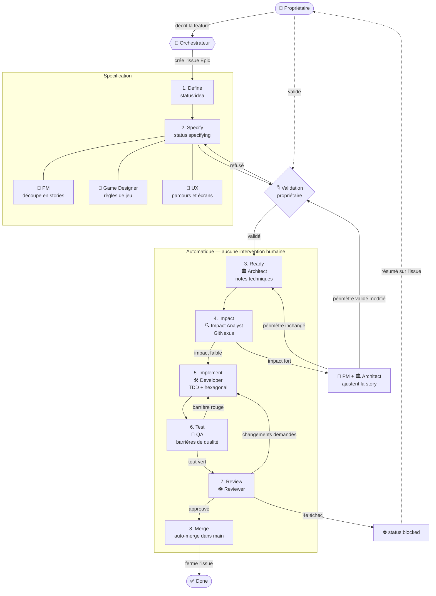

# Workflow Ascent

Inspiré de la [BMad Method](https://github.com/bmad-code-org/BMAD-METHOD). GitHub Issues est l'unique backlog. Le vocabulaire suit [`docs/glossary.md`](glossary.md).

## Principes

1. **Le propriétaire ne touche jamais au code.** Il définit les features et valide les stories. Tout le reste est automatique, jusqu'au merge dans `main`.
2. **Une seule validation humaine** : les stories d'une épique, avant le développement.
3. **Les barrières de qualité remplacent la relecture humaine.** Une PR n'est mergée que si toutes sont au vert.
4. **Le glossaire est la source de vérité** du vocabulaire. Les docs, le code et les tests l'utilisent tel quel.
5. **Une story = une branche = une PR.**

## Schéma du flow



## Vue d'ensemble

```
 1. DEFINE      Propriétaire → Orchestrateur          → issue Epic
 2. SPECIFY     PM + Game Designer + UX               → stories + critères Gherkin
                ✋ VALIDATION DU PROPRIÉTAIRE
 3. READY       Architect                             → notes techniques
 ──────────────────────── automatique ────────────────────────
 4. IMPACT      Impact Analyst (GitNexus)
                ├─ impact faible → 5
                └─ impact fort   → PM + Architect → retour en 2 ou 3
 5. IMPLEMENT   Developer                             → code + tests (TDD)
 6. TEST        QA                                    → toutes les barrières
 7. REVIEW      Reviewer                              → OK → 8, sinon → 5
 8. MERGE       Auto-merge dans main                  → issue fermée
```

## Statuts (labels GitHub)

| Label | Étape | Qui fait avancer |
|---|---|---|
| `status:idea` | 1. Define | Orchestrateur |
| `status:specifying` | 2. Specify | PM, Game Designer, UX |
| `status:awaiting-approval` | ✋ Validation | **Propriétaire** |
| `status:ready` | 3. Ready | Architect |
| `status:impact-analysis` | 4. Impact | Impact Analyst |
| `status:in-progress` | 5–6. Implement + Test | Developer, QA |
| `status:review` | 7. Review | Reviewer |
| `status:blocked` | Escalade | **Propriétaire** |
| *(issue fermée)* | 8. Merge | Auto |

Labels de type : `type:epic`, `type:story`, `type:bug`, `type:chore`.

## Les étapes en détail

### 1. Define — `/define-feature`
Le propriétaire décrit la feature dans le chat. L'orchestrateur crée une issue `type:epic` à partir du template [epic](../.github/ISSUE_TEMPLATE/epic.md) : objectif, valeur pour le joueur, périmètre, hors périmètre. Tout nouveau terme est ajouté au glossaire.

### 2. Specify — `/split-stories`
- **PM** : découpe l'épique en stories (sous-issues), chacune livrable et testable seule.
- **Game Designer** : règles de jeu, barèmes, équilibrage.
- **UX** : parcours et écrans.
- Les critères d'acceptation sont écrits en **Gherkin** et deviendront des tests exécutables.
- Le statut passe à `status:awaiting-approval`. L'orchestrateur résume les stories au propriétaire.

**✋ Le propriétaire valide.** Sans validation, rien ne part en développement.

### 3. Ready
L'**Architect** ajoute les notes techniques à chaque story : couches hexagonales touchées, ports et adaptateurs, données, risques.

### 4. Impact — analyse GitNexus
Avant toute ligne de code, l'**Impact Analyst** indexe le dépôt avec GitNexus et mesure ce que la story va toucher.

L'impact est **fort** si au moins un de ces points est vrai :
- un changement de modèle de données stockées (migration) ;
- une modification d'un port ou d'une règle du domaine utilisée par d'autres features ;
- plus de 10 fichiers existants modifiés, ou plus de 2 modules touchés ;
- une contradiction avec une autre story ouverte ou avec le glossaire.

Si l'impact est fort, la story revient au **PM** et à l'**Architect**, qui la redécoupent ou l'ajustent. La décision est tracée en commentaire sur l'issue. Si ce changement modifie ce que le propriétaire a validé, la story repasse par ✋.

### 5. Implement — `/dev-story`
Le **Developer** crée la branche `story/<n°>-<slug>` et travaille en TDD : le scénario Gherkin d'abord, puis les tests unitaires, puis le code. Il respecte l'architecture hexagonale.

### 6. Test
Le **QA** fait passer toutes les barrières de qualité ci-dessous, en local puis en CI.

### 7. Review — `/review-story`
Le **Reviewer** vérifie la PR par rapport aux critères d'acceptation, à l'architecture, au glossaire et aux rapports (coverage, mutation, Sonar). S'il y a un problème, retour en 5 avec des commentaires précis.

### 8. Merge
Quand toutes les barrières et la review sont au vert, la PR est mergée automatiquement dans `main` (squash). Elle porte `Closes #<story>`. L'épique est fermée quand toutes ses stories le sont.

## Barrières de qualité

Toutes sont **bloquantes**. Les outils sont indicatifs et seront confirmés par l'Architect lors de la mise en place.

| # | Barrière | Ce qu'elle garantit | Outil pressenti | Quand |
|---|---|---|---|---|
| 1 | **Secrets** | Aucun secret ne part dans le dépôt | Gitleaks | pre-commit + CI |
| 2 | **Style** | Formatage et style uniformes | Prettier + ESLint | pre-commit + CI |
| 3 | **Types** | Pas d'erreur de typage | TypeScript (`tsc --noEmit`) | pre-commit + CI |
| 4 | **Architecture** | Les dépendances respectent l'hexagonal (équivalent d'ArchUnit) | dependency-cruiser | CI |
| 5 | **Tests unitaires** | Domaine et cas d'usage | Jest | CI |
| 6 | **Tests d'intégration** | Adaptateurs + base locale + écrans | Jest + React Native Testing Library | CI |
| 7 | **Tests BDD** | Les critères d'acceptation Gherkin passent | Cucumber (`jest-cucumber`) | CI |
| 8 | **Tests end-to-end** | Parcours réels sur l'app | Maestro (mobile) ; Playwright si une version web apparaît | CI |
| 9 | **Tests de mutation** | Les tests détectent vraiment les bugs | StrykerJS | CI |
| 10 | **Coverage et qualité** | Seuils de couverture, code smells, duplication, sécurité | SonarQube Cloud | CI |
| 11 | **Glossaire** | Les termes nouveaux ou modifiés figurent dans `docs/glossary.md` | Revue (Reviewer) | Review |

### Seuils (ajustables)

| Mesure | Seuil |
|---|---|
| Coverage du code nouveau | ≥ 80 % |
| Coverage du domaine | ≥ 95 % |
| Score de mutation du code nouveau | ≥ 70 % |
| Score de mutation du domaine | ≥ 85 % |
| Quality gate SonarQube Cloud | Passed |
| Duplication du code nouveau | ≤ 3 % |

## Architecture hexagonale

```
src/
  domain/        règles métier pures — aucune dépendance externe
  application/   cas d'usage + ports (interfaces)
  adapters/      implémentations des ports (stockage, UI, auth…)
  app/           routes de l'app — ne contient que l'assemblage
```

Règles vérifiées par les tests d'architecture :
- `domain` n'importe rien hors de `domain`.
- `application` n'importe que `domain`.
- `adapters` implémentent les ports de `application` et n'importent pas d'autres adaptateurs.
- Seuls `adapters` et `app` connaissent le framework et les bibliothèques natives.

Conséquence pour les tests : le domaine et les cas d'usage se testent en unitaire, sans framework. Les adaptateurs se testent en intégration. Les parcours complets se testent en BDD et en end-to-end.

## Boucles et escalade

- **Review → Implement** : 3 tours au maximum. Au 4e échec, la story passe en `status:blocked` et l'orchestrateur résume le problème en commentaire sur l'issue au propriétaire.
- **Barrière rouge sur `main`** : priorité absolue, une story de correctif est créée immédiatement.
- **Impact fort** : décision du PM et de l'Architect, tracée sur l'issue. Le propriétaire n'est sollicité que si ce qu'il a validé change.

## Agents et skills

| Agent | Fichier | Étapes |
|---|---|---|
| Orchestrateur | `CLAUDE.md` (session principale) | Toutes |
| PM | `.claude/agents/pm.md` | 2, escalade d'impact |
| Game Designer | `.claude/agents/game-designer.md` | 2 |
| UX | `.claude/agents/ux.md` | 2 |
| Architect | `.claude/agents/architect.md` | 3, escalade d'impact |
| Impact Analyst | `.claude/agents/impact-analyst.md` | 4 |
| Developer | `.claude/agents/developer.md` | 5 |
| QA | `.claude/agents/qa.md` | 6 |
| Reviewer | `.claude/agents/reviewer.md` | 7 |

| Skill | Rôle |
|---|---|
| `/backlog` | Récupère les issues ouvertes et propose la suite |
| `/define-feature` | Étape 1 |
| `/split-stories` | Étape 2 |
| `/dev-story` | Étapes 3 à 8 pour une story `status:ready` |
| `/review-story` | Étape 7 sur une PR |
